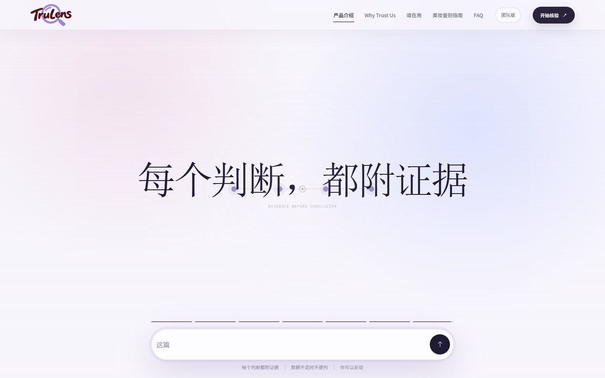
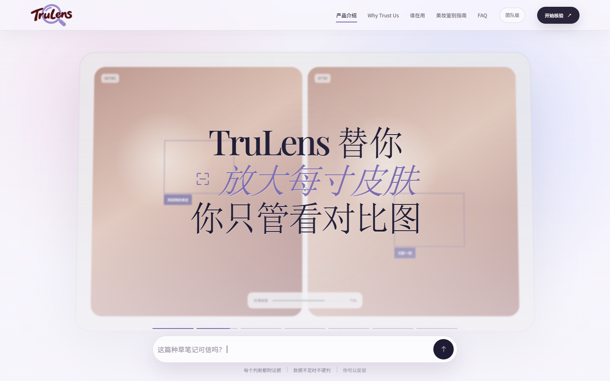
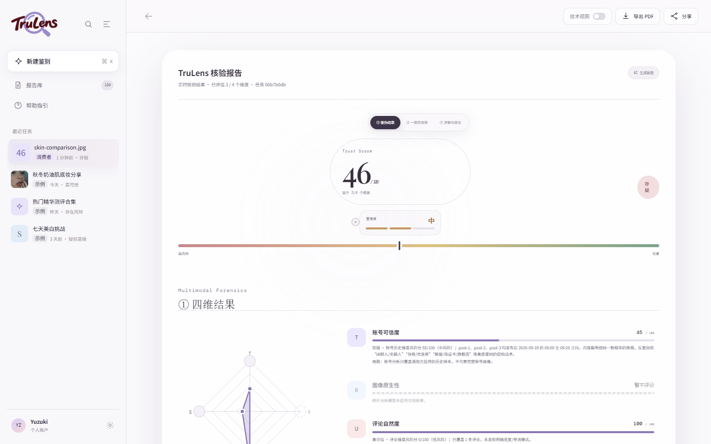

<div align="center">

# TruLens · 美妆内容可信度核验 Agent

一个面向美妆种草内容的可解释多模态内容可信度核验平台。

<p>
  
  
  
  
  
  
</p>



</div>

TruLens 将一条种草笔记拆解为 **T / R / U / S** 四个证据维度，输出综合可信度、逐维度风险分、证据卡、证据链、局限说明和处理建议。它强调的不是一句简单的「真 / 假」，而是把判断依据摊开给用户看。

| 实时核验 | 结构化报告 |
| :---: | :---: |
|  |  |

> 页面中的帖子、账号、评论和分数均为演示样本，不代表真实人物、真实品牌合作或平台裁决。

## 核心能力

| 维度 | Code | 分析内容 |
| --- | --- | --- |
| 账号可信度 | `T` | 发布节奏、带货占比、历史内容同质化；至少需要 3 篇历史内容 |
| 图片真实性 | `R` | 图片可见语义、图文一致性、C2PA / EXIF 来源记录，可接入视觉模型 |
| 评论区真实性 | `U` | 重复模板、近似重复、导流模式、发布集中度 |
| 文案真实性 | `S` | 绝对化表述、医疗化表达、无来源功效声明、合作披露 |

主要功能：

- 支持小红书笔记链接、分享文案、正文、评论、账号历史和图片输入
- 上传后自动创建分析任务，前端通过 `upload -> status -> report` 轮询真实分析状态
- 缺失的输入维度显示「暂不评分」，不参与综合分计算，也不被当作 0 分
- 输出 Trust Score、风险等级、逐维度证据、局限说明和下一步复核建议
- 内置启发式 Agent 与 `content-trust-engine-v10` 多模态引擎双后端，自动降级
- 创作者发布前自检、消费者核验、团队风险队列三种工作界面
- 报告支持导出、证据链查看、申诉和补充证据重新核验

## 界面预览

### 首页

首页以工作区为第一视觉重点，而不是营销落地页。用户可以在第一屏看到四个分析角色、证据如何形成结论，以及不同角色对应的处理建议。


### 实时核验

访问 `/?live=true` 进入独立实时核验页：

- 粘贴小红书链接，或手动填写文案、评论、账号历史
- 上传 JPG / PNG / WebP 图片
- 一键填入示例数据，或开始完整 T / R / U / S 核验


### 核验报告

报告页展示综合 Trust Score、风险带、四维分布、逐维度分数、证据、模型局限和建议动作。分数背后可以继续查看账号快照、素材溯源和报告总结。


## 系统架构

```text
React 19 + Vite
      |
      | /api
      v
FastAPI backend
      |
      +--> AnalysisService
      |      |
      |      +--> content-trust-engine-v10   (TRUST_ENGINE_ENABLED=true)
      |      |      + DeepSeek / GLM / Qwen
      |      |      + local fallback rules
      |      |
      |      +--> built-in heuristic agents
      |             + TextAgent / ImageAgent / CommentAgent / AccountAgent
      |
      +--> Xiaohongshu crawler (optional)
      +--> SQLite / PostgreSQL
      +--> FileService (uploaded images and provenance metadata)
```

后端默认使用内置启发式 Agent，因此没有 API Key 也能完成基础演示。启用 `TRUST_ENGINE_ENABLED=true` 后，只要 `content_trust` 包可用，引擎会接管分析维度并生成可审计的执行轨迹。

## 评分口径

内部分数都是风险分，越高越危险。API 边界再转换为前端展示用的可信分：

```text
trust_score = 100 - overall_score
```

| 维度 | 默认权重 |
| --- | ---: |
| `text` 文案真实性 | 0.35 |
| `image` 图片真实性 | 0.30 |
| `comment` 评论区真实性 | 0.20 |
| `account` 账号可信度 | 0.15 |

只有实际评估且返回分数的维度参与加权，权重会重新归一化。

综合风险阈值：

| 后端 | 中风险 | 高风险 |
| --- | ---: | ---: |
| `content_trust` 引擎 | 30 | 60 |
| 内置启发式 Agent | 35 | 70 |

> TruLens 输出的是风险提示和人工复核优先级，不是内容为假、账号为机器人或产品无效的概率。

## 快速开始

### 1. 启动后端

要求 Python 3.11+。

```bash
cd backend
python -m venv .venv

# macOS / Linux
source .venv/bin/activate

# Windows PowerShell
.\.venv\Scripts\Activate.ps1

pip install -r requirements.txt
copy .env.example .env
python run.py
```

后端默认运行在 `http://127.0.0.1:8000`，交互式 API 文档位于 `http://127.0.0.1:8000/docs`。

### 2. 启动前端

```bash
cd fronted
npm install
npm run dev
```

打开 `http://127.0.0.1:8443`。

实时核验页：

```text
http://127.0.0.1:8443/?live=true
```

前端开发服务器默认将 `/api` 代理到 `http://127.0.0.1:8000`。如果后端运行在其他端口，可通过 `VITE_API_TARGET` 覆盖：

```bash
cd fronted
VITE_API_TARGET=http://127.0.0.1:8010 npm run dev
```

### 3. 启用内容可信度引擎

最小演示不依赖任何外部模型。需要完整的多模态路径时：

```bash
cd backend
pip install -r requirements-engine.txt
pip install -e ../content-trust-engine-v10
```

在 `backend/.env` 中配置：

```dotenv
TRUST_ENGINE_ENABLED=true
DEEPSEEK_API_KEY=your_deepseek_key
GLM_API_KEY=your_glm_vision_key
```

`DeepSeek` 未配置时，文案、评论和账号维度会降级到本地规则。`GLM_API_KEY` 未配置且没有 `QWEN_API_KEY` 时，图片维度会明确显示「暂不评分」，不会伪造结论。

### Docker

默认镜像已经包含 `content-trust-engine-v10`：

```bash
docker compose -f backend/docker-compose.yml up --build
```

只构建不含引擎的轻量后端：

```bash
BUILD_TARGET=lean docker compose -f backend/docker-compose.yml up --build
```

启用 PostgreSQL profile：

```bash
docker compose -f backend/docker-compose.yml --profile postgres up --build
```

## API

核心流程：

```text
POST /api/upload
  -> GET /api/status/{task_id}
  -> GET /api/report/{task_id}
```

主要端点：

| 方法 | 路径 | 说明 |
| --- | --- | --- |
| `GET` | `/api/health` | 健康检查与当前分析后端 |
| `GET` | `/api/agents` | 可用分析维度和流水线 |
| `POST` | `/api/upload` | 上传内容并创建分析任务 |
| `POST` | `/api/analyze/{task_id}` | 启动或重新分析任务 |
| `GET` | `/api/status/{task_id}` | 查询任务进度和维度状态 |
| `GET` | `/api/report/{task_id}` | 获取完整可信度报告 |
| `GET` | `/api/samples/{sample_id}` | 获取原始样本和图片元信息 |
| `GET` | `/api/engine-trace/{task_id}` | 获取模型引擎的完整执行轨迹 |
| `GET` | `/api/team/queue` | 团队风险队列 |
| `POST` | `/api/creator/check` | 创作者发布前自检 |

完整字段、状态机、错误码和环境变量见 [backend/docs/API_CONTRACT.md](backend/docs/API_CONTRACT.md)。

## 项目结构

```text
olay/
├── fronted/                     # React 19 + Vite 前端
│   ├── src/
│   │   ├── App.tsx              # 首页、工作区、对话和报告流程
│   │   ├── LiveAnalysis.tsx     # 独立实时核验页
│   │   ├── LiveReport.tsx       # 共享报告视图
│   │   ├── useLiveAnalysis.ts   # 上传、轮询和报告状态源
│   │   └── api.ts               # 类型化 API 客户端
│   └── public/                  # Logo、演示素材和证据图片
├── backend/                     # FastAPI 服务
│   ├── app/
│   │   ├── agents/              # 内置启发式 Agent
│   │   ├── services/            # 分析、报告、团队、抓取和引擎接入
│   │   ├── models/              # SQLAlchemy 数据模型
│   │   └── schemas/             # Pydantic API Schema
│   ├── tests/                   # API 契约和端到端测试
│   └── docs/API_CONTRACT.md     # 前后端联调契约
├── content-trust-engine-v10/    # 可选的多模态可信度引擎
│   ├── content_trust/           # Python 包
│   ├── prompts/                 # 版本化模型提示词
│   └── tests/                   # 引擎单元测试
├── xhs/                         # 小红书抓取器
└── docs/screenshots/            # README 界面截图
```

## 测试与验证

```bash
# 后端
cd backend
./.venv/Scripts/python -m pytest
./.venv/Scripts/python scripts/smoke_test.py

# 引擎集成
./.venv/Scripts/python scripts/engine_smoke_test.py

# 前端
cd ../fronted
npm run build
```

macOS / Linux 下将 `.venv/Scripts/python` 替换为 `.venv/bin/python`。

`scripts/smoke_test.py` 会在隔离的临时 SQLite 数据库中完成 `上传 -> 四维分析 -> 报告` 全链路，不污染本地开发数据。

## 当前边界

- 当前版本是黑客松原型，接口没有鉴权，生产部署前需要增加身份认证和权限控制。
- 暂无任务列表 / 历史任务查询 API，前端目前只能通过已有 `task_id` 查询。
- 小红书抓取需要在 Chrome 中登录一次，具体配置见 `backend/.env.example`。
- 图片真实性依赖外部视觉模型；未配置 Key 时，R 维度保持「暂不评分」。
- 评论文本模式只能提示异常，不能证明评论为假、付费或协同。
- 引擎交付包中仍有少量测试断言未随最新 schema 更新，详见 [content-trust-engine-v10/DELIVERY_NOTES.md](content-trust-engine-v10/DELIVERY_NOTES.md)。

## 相关文档

- [后端 API 契约](backend/docs/API_CONTRACT.md)
- [产品设计 Spec](design-spec.md)
- [品牌资产与使用边界](brand-spec.md)
- [Content Trust Engine README](content-trust-engine-v10/README.md)

## License

当前仓库尚未包含 `LICENSE` 文件。除非仓库所有者后续明确发布授权条款，否则默认保留所有权利。
