<div align="center">

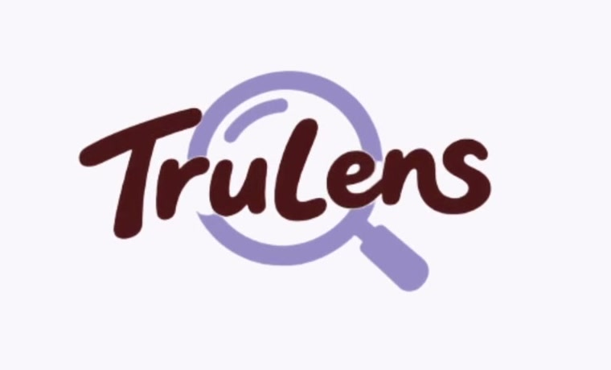

# TruLens · 让每一次相信，都有依据

**面向美妆护肤种草内容的多模态真实性核验 Agent**

一篇种草笔记能不能信？TruLens 同时派出四位 AI 专家——账号、图片、评论、文案——各自取证、两两对质，最后汇成一份附证据、可申诉、按身份给出下一步建议的核验报告。

**Trust, with evidence.**

[](backend/)
[](backend/)
[](fronted/)
[](fronted/)
[](fronted/)
[](backend/docker-compose.yml)
[](backend/tests/)

**GitHub 仓库**：[github.com/EAnge1o/olay](https://github.com/EAnge1o/olay)

[功能亮点](#-功能亮点) · [界面一览](#-界面一览) · [快速开始](#-快速开始) · [系统架构](#-系统架构) · [评测](#-评测) · [文档](#-文档)

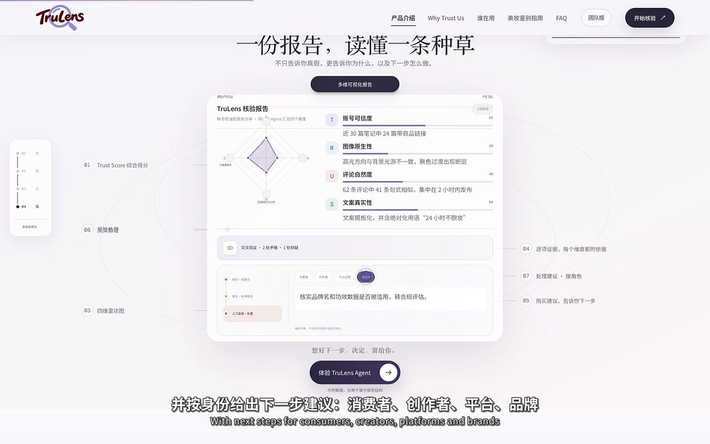

</div>

---

## ✨ 功能亮点

**🔍 四位 AI 专家，同时出动**
四个维度并行取证，而不是一个黑盒打分：

| 维度 | 专家 | 看什么 |
|:---:|---|---|
| **T** · 账号可信度 | 账号侦探 | 发布节奏、带货占比、历史内容一致性 |
| **R** · 图片真实性 | 视觉取证师 | 高光与光源、肤质过渡、局部纹理异常 |
| **U** · 评论区真实性 | 口碑观察员 | 句式相似度、集中发布时间、水军模式 |
| **S** · 文案真实性 | 文案检查官 | 模板化话术、绝对化功效、断言是否有来源 |

**⚖️ 四个结果，先对质，再汇成一个分数**
交叉验证把 T/R/U/S 两两比对，可信方向不一致的地方会被明确标出（例如"账号可信度 65 vs 文案真实性 25，分差 40，建议复核"），总分由分数、风险等级与证据数量共同计算，关系状态来自各维度分数与证据数量。

**🧾 每个判断，都附证据**
报告区分 observation / evidence / inference，每条结论都有证据强度、来源、材料局限和分级处置建议（放行 · 轻提示 → 提示 · 补充核验 → 人工复核 · 处置）；材料不足时显示"暂不评分"，绝不假装打分。

**🗣️ 不认同？可以申诉**
用户可以对任何一个维度的结论提交申诉，查看原始信号与交叉关系，系统回应并公开评判过程。

**🧴 创作者发布前自检**
发布之前先交给自己审：粘贴文案与配图，得到逐条可解释的修改建议和"可以发布 / 建议修改"结论。

**👥 团队版 · 批量核验**
面向平台与品牌方：按风险排序的核验队列、风险/置信度分布、疑似同源内容自动成组（关联分组）、一键导出复核报告。

**🔗 两种输入方式**
文案 / 图片上传，或直接粘贴笔记链接（小红书采集，可选启用）。

**🧯 负责任的 AI**
所有演示帖子、评论、账号与分数均标注为虚构样本；AI 辅助判断，不替代平台最终裁决或医学结论。

## 🎬 界面一览

**官网首页 · 一篇种草笔记能不能信？TruLens 替你核实**

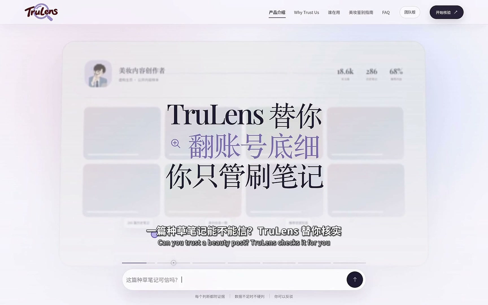

**四个维度，各自取证（T · 账号可信度）**

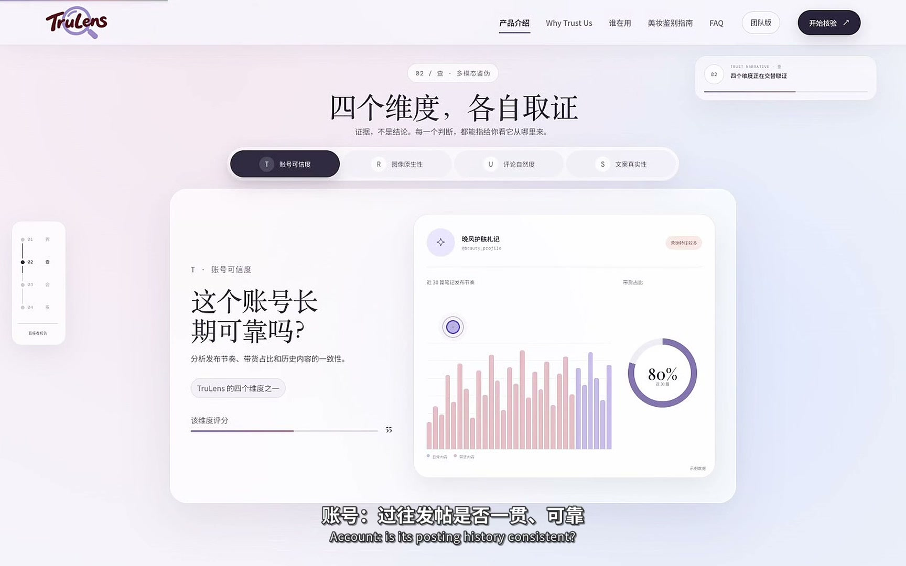

**核验工作台 · 粘贴正文、上传配图，补充评论区与账号历史**

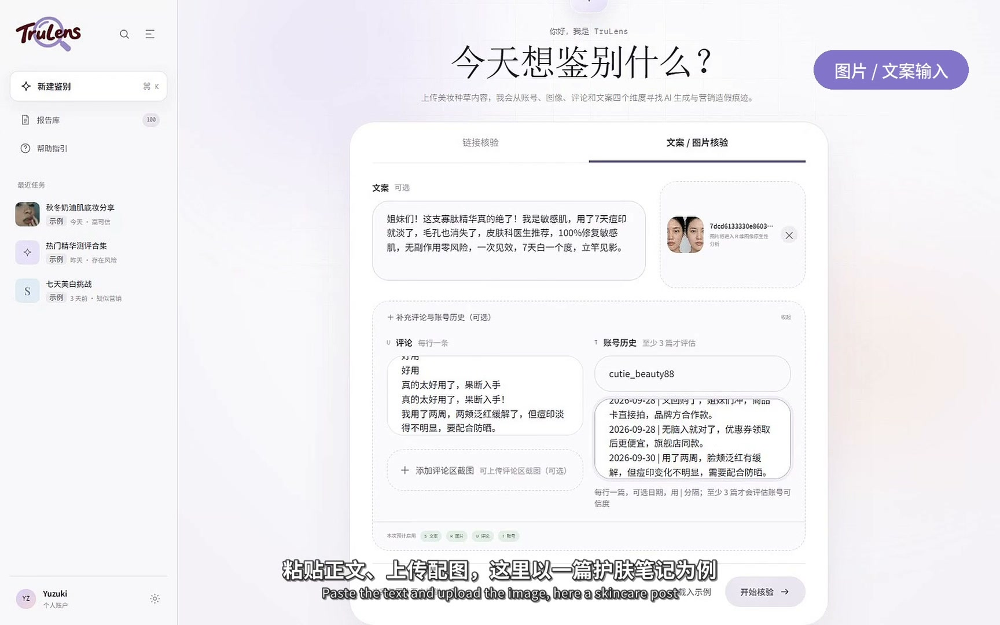

**交叉验证 · 两个维度存在明显分差，建议复核**

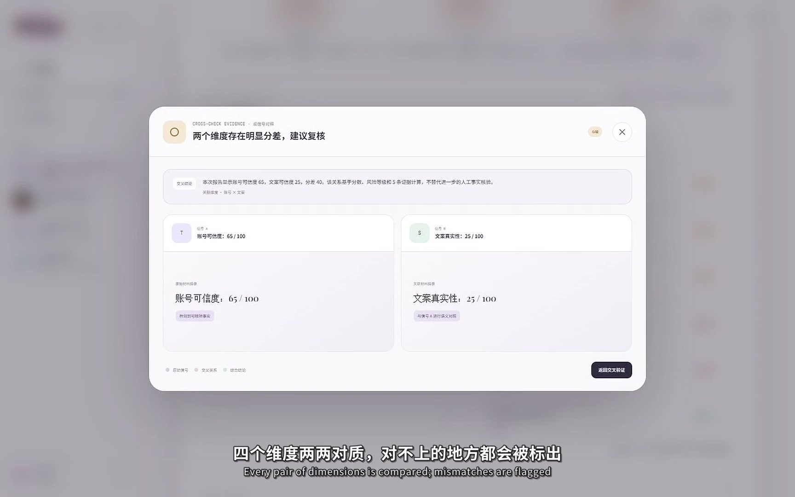

**决策与建议 · 分级策略，按消费者 / 创作者 / 平台运营 / 品牌方给出下一步**

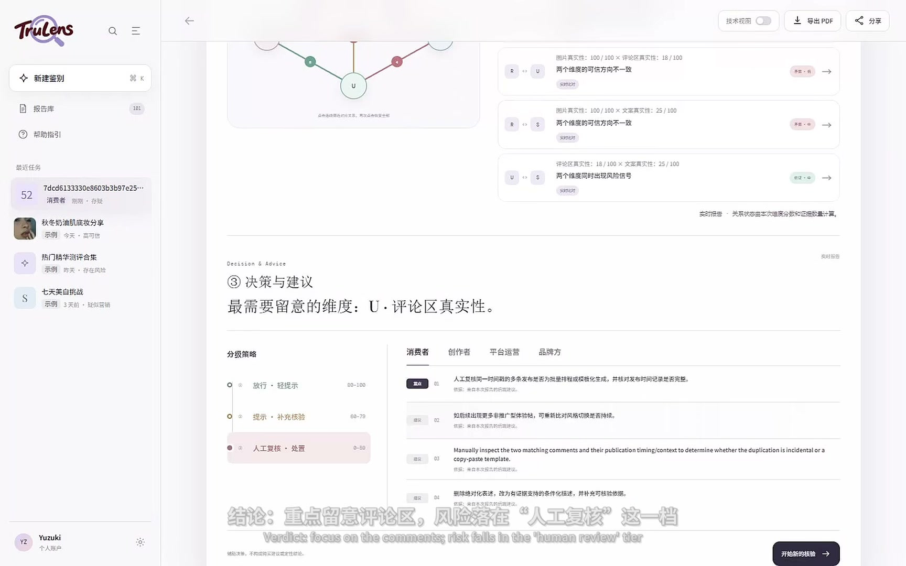

**创作者发布前自检 · 可信度 75/100，已核验 1/4 个维度，未评估的维度显示"暂不评分"**

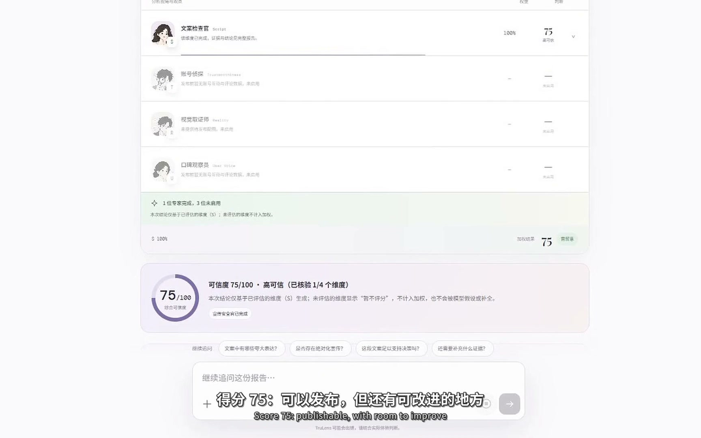

**团队版 · 批量核验队列（按风险排序、问题类型筛选、导出复核报告）**

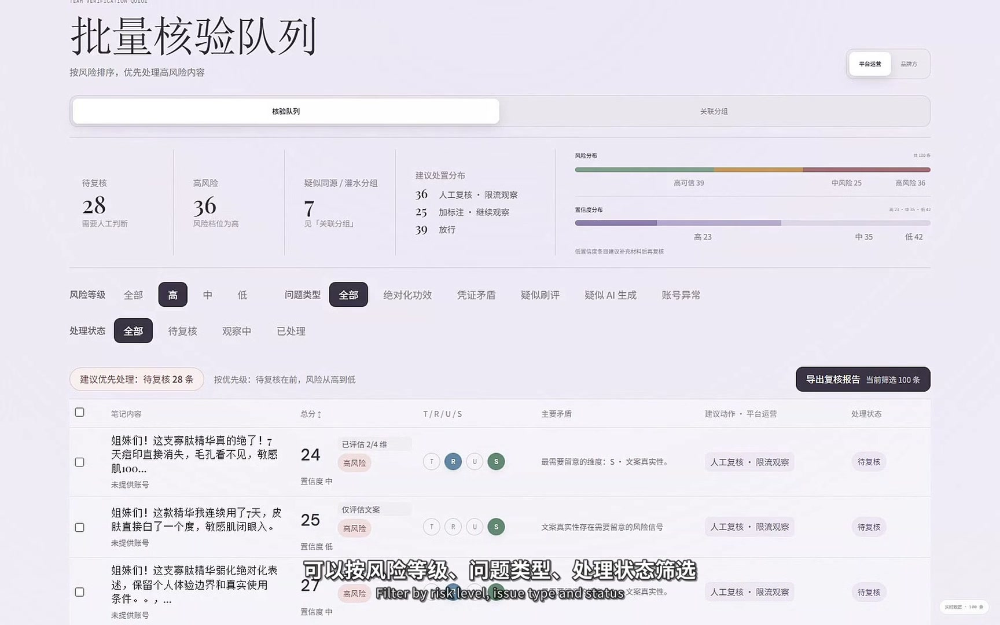

## 🚀 快速开始

### Docker（推荐）

```bash
cd backend
docker compose up --build                  # 默认镜像内置内容信任引擎 + SQLite
# BUILD_TARGET=lean docker compose up --build      # 不含引擎包的精简镜像
# docker compose --profile postgres up --build     # PostgreSQL 生产形态
```

启动后打开 <http://127.0.0.1:8000/docs> 查看交互式 API 文档。

### 手动运行

**后端**（Python 3.11+）

```bash
cd backend
python -m venv .venv
source .venv/bin/activate          # Windows: .venv\Scripts\activate
pip install -r requirements.txt
cp .env.example .env               # 默认 mock provider，无需任何 API key 即可启动
python run.py                      # http://127.0.0.1:8000
```

可选增强：

```bash
pip install -r requirements-engine.txt
pip install -e ../content-trust-engine-v10    # 启用独立内容信任引擎
# 并在 .env 中设置 TRUST_ENGINE_ENABLED=true
pip install -r requirements-xhs.txt           # 启用小红书链接采集（需要 Chrome）
```

**前端**（Node 18+）

```bash
cd fronted
npm install
npm run dev                        # http://localhost:8443，/api 已代理到 127.0.0.1:8000
```

**接入真实模型**：在 `backend/.env` 中配置 `GLM_API_KEY`（图像维度，多模态视觉模型）与 `DEEPSEEK_API_KEY`（文案 / 评论 / 账号维度与解释生成），未配置的维度自动降级为本地规则，缺材料时明确显示"暂不评分"。

## 🏗️ 系统架构

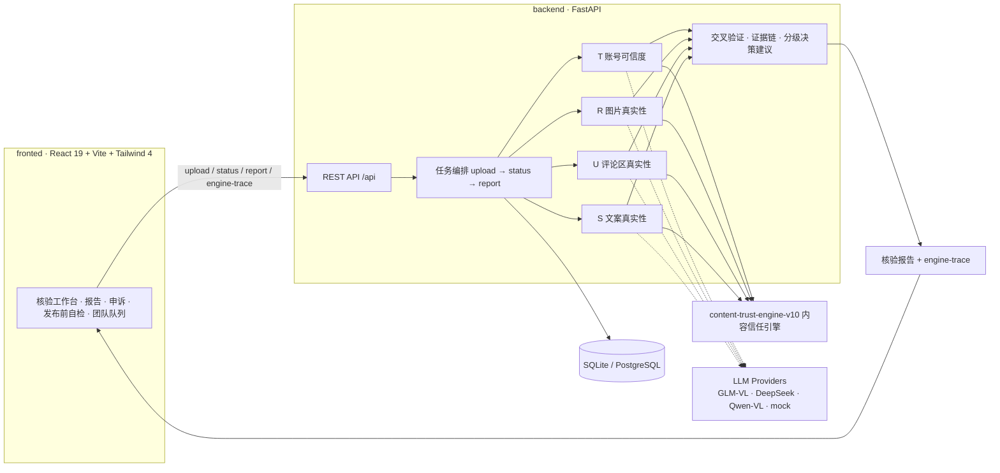

- **可插拔模型**：`LLM_PROVIDER=mock` 开箱即跑；GLM-VL 驱动图像维度（自动重试、尊重 Retry-After），DeepSeek 驱动文案 / 评论 / 账号维度，Qwen-VL 作为视觉备选。
- **独立引擎**：`content-trust-engine-v10` 提供稳定的同步 Python API，把 observation、evidence、inference 分层，输出 `review_priority` 人工分流建议。
- **免 CORS**：前端 dev server 代理 `/api` 到后端，客户端始终同源。

## 📡 核心 API

| 方法 | 路径 | 说明 |
|:---:|---|---|
| `POST` | `/api/upload` | 提交正文、评论、账号历史与图片，创建自动分析任务 |
| `GET` | `/api/status/{task_id}` | 轮询任务状态 `pending / running / completed / failed` |
| `GET` | `/api/report/{task_id}` | 总分、风险等级、四维分数、证据、交叉验证、决策建议与置信度 |
| `GET` | `/api/engine-trace/{task_id}` | 角色运行轨迹、证据链、主要证据、限制与模型元数据 |

完整契约见 [backend/docs/API_CONTRACT.md](backend/docs/API_CONTRACT.md)。

## 📊 评测

`eval/run_eval.py` 对运行中的服务做黑盒评估（不修改后端代码、模型调用与阈值）：`competition-submission/TruLens_TestDataset` 的 22 条样本（18 条伪造 + 4 条对照），覆盖四维分数、总分、风险等级、交叉验证摘要与耗时。

```bash
python eval/run_eval.py    # 先启动后端；结果写入 eval/results.csv 与 eval/summary.md
```

## 🧪 测试

```bash
cd backend
pytest                     # 契约、API 流程、engine-trace 等测试
```

## 📁 目录结构

```
olay/
├── fronted/                    # React 19 + Vite + Tailwind 4 前端（工作台 / 官网 / 团队版）
├── backend/                    # FastAPI 服务
│   ├── app/agents/             # account · image · comment · text 四位 AI 专家
│   ├── app/api/                # upload · status · report · engine-trace
│   ├── app/services/llm/       # GLM-VL / DeepSeek / Qwen-VL / mock 可插拔 provider
│   ├── tests/                  # pytest 契约与流程测试
│   └── docker-compose.yml      # 一键启动（默认内置引擎，可选 PostgreSQL）
├── content-trust-engine-v10/   # 独立内容信任分析引擎（observation / evidence / inference）
├── eval/                       # 22 条样本黑盒评测脚本与结果
├── competition-submission/     # 比赛材料：源码包、测试数据集、设计文档
└── docs/images/                # README 截图资产
```

## 👥 团队

**No Five Days** · 2026 L'Oréal Beauty Tech 挑战赛「信任守护师 · 创造者的 AI 卫士」赛题作品。

<div align="center">

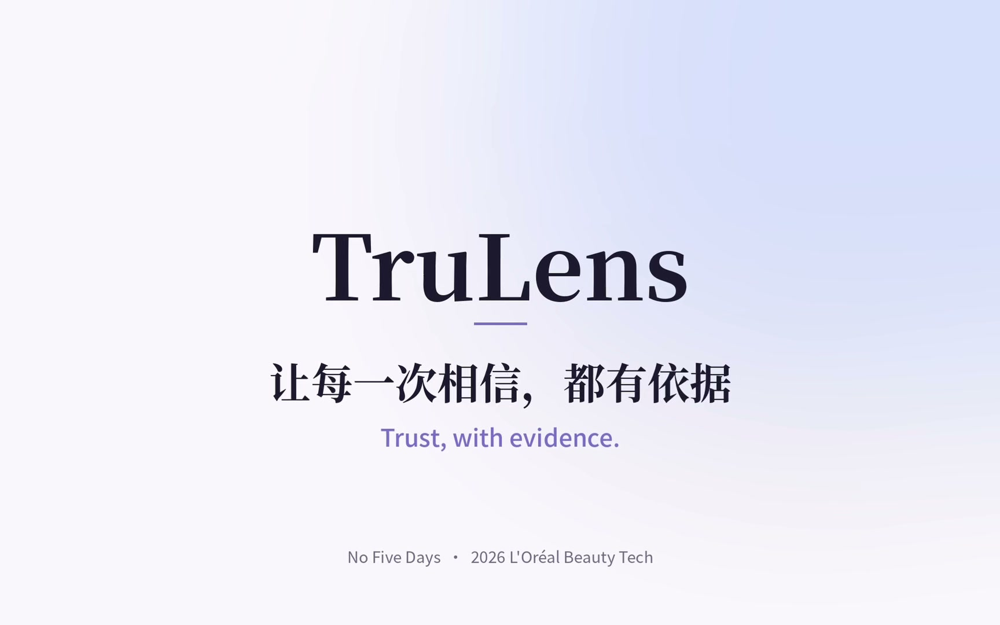

**让每一次相信，都有依据。** *Trust, with evidence.*

</div>

---

> ⚠️ **免责声明**：本项目内所有演示帖子、评论、账号与分数均为虚构样本 / 演示数据；TruLens 提供的是 AI 辅助判断，不构成平台最终裁决或医学结论；未提供充分材料时对应维度显示「暂不评分」。
