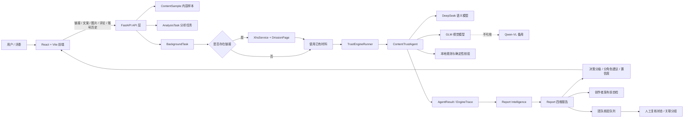
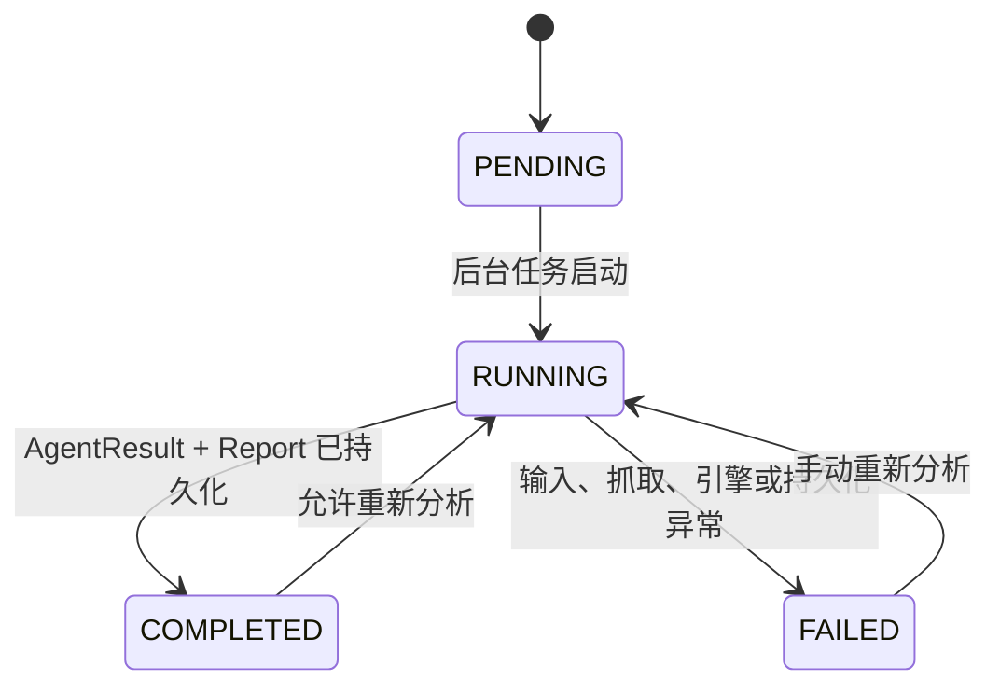
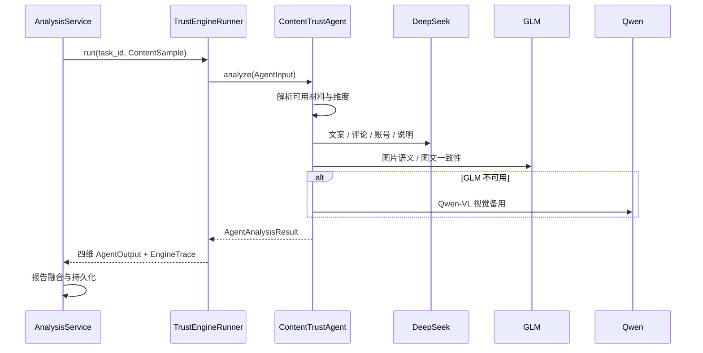
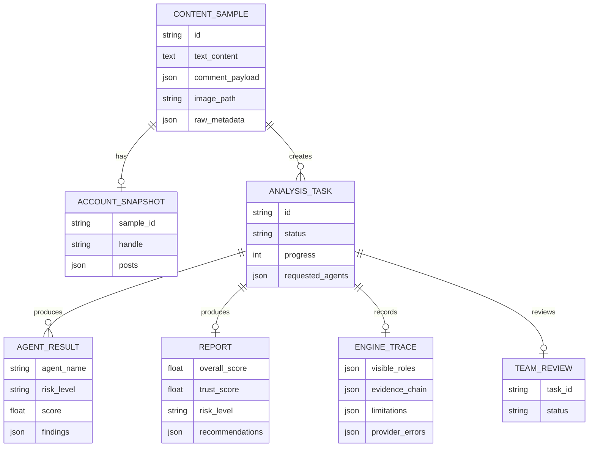

# TruLens AI Agent 设计文档

**版本：** v1.0  
**文档日期：** 2026-10-20  
**对应项目：** TruLens 美妆内容可信度核验 Agent 平台  
**文档定位：** 面向比赛评审、技术评审和后续开发人员，说明系统如何从真实输入完成“多模态鉴伪、语义一致性校验、决策与建议输出”的完整闭环，并说明工程实现、降级策略和可运行形态。

---

## 0. 设计结论

TruLens 不是一个单模型的聊天演示，而是一套任务型的多 Agent 内容核验系统。

系统以 `task_id` 为一次核验任务的唯一上下文，将用户提交的链接、文案、图片、评论和账号历史统一转换为 `ContentSample`，随后由 `AnalysisService` 编排分析流程。分析引擎围绕四个可解释维度工作：

- **T 账号可信度**：账号历史、发布节奏、合作信息和内容稳定性。
- **R 图片真实性**：图片可见内容、修图/生成线索、来源元数据和图文一致性。
- **U 评论区真实性**：评论重复、模板化、促销话术和异常传播模式。
- **S 文案真实性**：绝对化功效、缺少依据的 claim、内部矛盾和声明边界。

四维结果不会直接拼成一句结论，而是继续进入：

1. 维度间交叉验证；
2. 权重归一和风险聚合；
3. 置信度与缺失材料说明；
4. 放行 / 补充核验 / 人工复核分级；
5. 消费者、创作者、平台运营、品牌方四类角色的下一步建议；
6. 证据链、原始材料和执行轨迹回看。

因此，系统覆盖了从输入采集到业务处置的完整链路，而不是只停留在模型输出 JSON 的算法演示。

---

## 1. 对官方考察方向的直接回应

| 官方的考察方向 | TruLens 的实现 |
|---|---|
| 多模态鉴伪 | T/R/U/S 四个维度分别处理账号、图片、评论和文案；支持链接抓取、单图、评论和账号历史。 |
| 语义一致性校验 | 引擎执行 claim 与证据对照、图文语义一致性检查，服务端再基于四维分数和证据生成六组交叉验证关系。 |
| 决策与建议输出 | 生成 Trust Score、风险等级、置信度、缺失材料、决策分级和四类角色建议。 |
| 可运行的完整项目 | React 前端、FastAPI 后端、独立分析引擎、SQLite/PostgreSQL、Docker、测试和演示样本均已提供。 |
| 可展示的完整闭环 | 消费者核验、报告追问、申诉记录、创作者发布前自检、团队复核队列和关联分组均已接入页面与 API。 |

本项目的核心设计原则是：**模型负责发现语义线索，系统负责组织证据、约束结论并给出下一步动作。**

---

## 2. 总体架构



### 2.1 分层职责

| 层级 | 主要组件 | 职责 |
|---|---|---|
| 展示层 | `frontend/` | 输入、识别确认、分析进度、报告、证据弹窗、角色建议、创作者自检、团队队列。 |
| 接口层 | `backend/app/api/` | 上传、分析、状态轮询、报告、引擎轨迹、创作者、团队和健康检查 API。 |
| 业务编排层 | `AnalysisService` | 创建任务、链接抓取、调用引擎、映射维度结果、持久化和错误处理。 |
| 智能体层 | `ContentTrustAgent` / `ContentTrustEngine` | 自动选择可用维度、调用模型、生成 claim、证据链、维度评估和综合报告。 |
| 模型适配层 | `DeepSeekClient` / `glm_vision.py` / `QwenVisionClient` | 统一模型调用和供应商错误处理，隔离具体 API 差异。 |
| 数据层 | SQLite / PostgreSQL | 内容样本、账号快照、分析任务、维度结果、报告、执行轨迹和团队复核状态。 |
| 部署层 | Vite / Uvicorn / Docker | 本地运行、生产构建和容器化后端。 |

---

## 3. 数据流转

### 3.1 输入采集

前端提供三类真实入口：

1. **文案/图片核验**：文案、单张配图、评论列表、账号名和近期笔记。
2. **链接核验**：小红书笔记链接或分享文本；后端保留 `xsec_token` 并规范化链接。
3. **创作者发布前自检**：草稿文案、可选首张配图、合作状态和品类。

`POST /api/upload` 的职责不是立刻运行模型，而是完成输入规范化和任务创建：

- 校验至少存在一种有效材料；
- 规范化评论与账号历史；
- 保存图片并计算文件元数据；
- 将链接解析为规范 URL；
- 创建 `ContentSample`；
- 可选创建 `AccountSnapshot`；
- 创建 `AnalysisTask`；
- 提交数据库后由 `BackgroundTasks` 启动异步分析。

链接抓取不会阻塞上传请求。链接只会在后台任务的 `_ensure_ingested()` 阶段被真正抓取，并在 `raw_metadata["ingested"]` 中记录状态，避免重复打开浏览器。

### 3.2 链接内容归一化

链接抓取链路为：

```text
前端链接
  → XhsService.normalize()
  → scripts/xhs_fetch.py
  → xhs/XhsExtractor/Crawler.py
  → Chromium / DrissionPage
  → 标题、正文、图片、评论、作者主页
  → ContentSample + AccountSnapshot
```

设计约束：

- 公开笔记链接默认不需要登录；
- 完整分享链接中的 `xsec_token` 会保留；
- 如果遇到登录页、安全限制或风控页面，返回明确错误，不伪造抓取内容；
- 抓取失败不会让系统悄悄使用空内容；
- 用户可改用文案/图片核验作为降级路径。

### 3.3 统一的内容样本

所有入口最终归一化到同一份 `ContentSample`：

```json
{
  "text_content": "待核验文案",
  "comment_payload": ["评论 1", "评论 2"],
  "image_path": "storage/uploads/xxx.png",
  "image_meta": {
    "sha256": "...",
    "width": 1440,
    "height": 1920
  },
  "source": "xiaohongshu | manual | creator-selfcheck",
  "raw_metadata": {
    "source_url": "...",
    "ingested": true
  }
}
```

这样，手动输入、链接抓取和创作者自检可以共享同一套分析服务，而不需要复制三套模型逻辑。

---

## 4. Agent 编排闭环

### 4.1 任务状态



任务进度大致经过：

```text
0% → 5% 初始化
→ 10% 创建维度结果行
→ 12% / 20% 链接抓取和材料落地
→ 20%–90% 维度分析和结果持久化
→ 90% 报告融合
→ 100% 完成
```

前端轮询 `GET /api/status/{task_id}`，展示任务状态、进度和四个角色的运行情况。

### 4.2 两种分析后端

`AnalysisService._produce_outcomes()` 支持两种执行模式：

#### 模式 A：完整分析引擎

当 `TRUST_ENGINE_ENABLED=true` 且 `content_trust` 可导入时：

1. `TrustEngineRunner.run()` 构造引擎输入；
2. 通过 `asyncio.to_thread()` 调用同步引擎，避免阻塞 FastAPI 事件循环；
3. `ContentTrustAgent.analyze()` 一次调用完成可用维度的分析；
4. 将引擎输出映射为既有的 `AgentOutput`；
5. 将富轨迹写入 `engine_traces`；
6. 将四维结果写入 `agent_results`。

#### 模式 B：内置启发式回退

当引擎不可用、未安装或不可评估时：

1. 使用后端的 `AgentRegistry` 获取 T/R/U/S Agent；
2. 通过 `asyncio.gather()` 并发执行独立 Agent；
3. 单个 Agent 失败不会导致其他维度全部失败；
4. 仍由同一个 `ReportAgent` 和报告服务完成融合。

```python
outcomes, engine_run = await self._produce_outcomes(...)
```

这一设计保证了：

- 比赛演示不依赖某一次模型服务是否在线；
- 模型不可用时仍有可解释的规则结果；
- 两种后端输出同一套公开报告结构；
- 前端不需要理解模型供应商差异。

### 4.3 并发与一致性

- 启发式模式下的独立 Agent 可以通过 `asyncio.gather()` 并发；完整引擎模式由 `ContentTrustAgent` 单次编排，内部按阶段完成多个维度；
- 数据库写入只在任务所属的 `AsyncSession` 中串行执行；
- 进程内 `_running` 集合避免同一任务被上传自动分析和手动分析重复执行；
- 重新分析会先清理旧的 `AgentResult`、`Report` 和 `EngineTrace`；
- 所有任务以 `task_id` 关联内容、结果、报告和轨迹。

---

## 5. 模型调用设计

### 5.1 当前主链路

| 角色 | 业务维度 | 首选模型/能力 | 输出 | 失败策略 |
|---|---|---|---|---|
| 文案检查官 | S 文案真实性 | DeepSeek Flash | claim 抽取、绝对化/缺依据判断、内部一致性 | 本地 claim 规则回退 |
| 口碑观察员 | U 评论区真实性 | DeepSeek Flash + 本地模式规则 | 重复评论、模板话术、促销模式、异常集中 | 本地重复/促销规则 |
| 账号侦探 | T 账号可信度 | DeepSeek Flash + 账号规则 | 发布节奏、主题稳定性、合作/导购信号 | 规则评分或暂不评分 |
| 视觉取证师 | R 图片真实性 | GLM-5.3-FlashX | 可见内容、修饰/生成线索、图文语义一致性 | Qwen-VL 备用；缺失则图片维度不可用 |
| 解释与建议 | 报告摘要 | DeepSeek Flash | 综合说明、主要证据、建议动作 | 本地模板整理 |

### 5.2 调用关系



### 5.3 模型边界

- 模型输出的是**语义线索和风险判断**，不是平台裁决或医学结论。
- 主链路的 R 维度是图文语义和可见内容筛查；独立像素级模型不作为默认主链路。
- 没有视觉模型 Key 时，R 维度显示“不可用/暂不评分”，不会伪造 0 分。
- AI 文风信号只作为来源/风格线索，不参与整体风险评分。
- 图片、评论、账号和文案都存在材料边界，报告会显示对应 limitations。

### 5.4 供应商错误与追踪

`EngineTrace` 保存：

- `visible_roles`：四位可见角色、provider、model、prompt version 和状态；
- `evidence_chain`：证据链；
- `major_evidence`：主要证据；
- `limitations`：限制；
- `dimension_assessments`：维度评估；
- `provider_errors`：模型/供应商错误；
- `model_metadata`：模型和 prompt 版本；
- `latency_ms`：本轮耗时。

前端通过 `GET /api/engine-trace/{task_id}` 展示可追踪的工程信息，而不是只展示最终分数。

---

## 6. 多模态鉴伪设计

### 6.1 四个维度

#### T · 账号可信度

输入包括账号名、简介、粉丝数、历史帖子、发布时间和内容主题。

分析重点：

- 历史内容主题是否连续；
- 发布节奏是否异常集中；
- 是否存在显著导购/合作密度；
- 账号信息是否足够完成比较。

账号历史少于最低材料量时，不强行打分，而是明确标注未评估。

#### R · 图片真实性

输入为单张首图或截图。

分析重点：

- 图片可见内容与产品主体；
- 纹理、边缘、光影等语义线索；
- 图片中的可见文字；
- 图片文字与正文 claim 的一致性；
- 可选 C2PA/EXIF 来源线索。

R 维度是“语义鉴伪 + 图文一致性 + 来源线索”的组合，不会被包装成像素级概率。

#### U · 评论区真实性

输入为评论内容、作者和发布时间。

分析重点：

- 完全重复或近重复短评；
- 模板化促销话术；
- 评论发布时间集中；
- 评论观点是否与同类体验分布异常一致；
- 是否存在与正文不相符的集中支持话术。

评论结果只表示文本模式线索，不推断真实购买、真实用户身份或付费关系。

#### S · 文案真实性

输入为正文、补充证据和可选外部证据。

分析重点：

- claim 抽取；
- 绝对化功效；
- 缺少依据的结论；
- 医疗化或安全性保证；
- 文案内部矛盾；
- 个人体验边界和披露。

### 6.2 权重与聚合

引擎默认风险权重为：

```text
S 文案：0.35
R 图片：0.30
U 评论：0.20
T 账号：0.15
```

只有已评估维度参与聚合，剩余权重会按可用维度重新归一化。缺少材料的维度显示“暂不评分”，不会用 0 分代替真实结果。

综合风险分为 0–100 的风险分，对外展示的 Trust Score 为：

```text
trust_score = 100 - overall_risk_score
```

风险阈值：

- `0–29`：低风险；
- `30–59`：中风险；
- `60–100`：高风险。

---

## 7. 语义一致性校验

语义一致性分为两层。

### 7.1 图文跨模态校验

`CrossModalAnalyzer` 将图片与正文 claim 放在同一上下文中，比较：

- 图片是否展示了文案声称的产品与区域；
- 前后对比图是否具有可解释的拍摄条件；
- 图片中的可见文字是否与正文一致；
- 图片修饰/生成线索是否削弱 claim 的证据力；
- 图片与文案之间是否存在可见矛盾。

输出为：

- `crossmodal_analysis`；
- `image_text_findings`；
- claim 与图片证据的关联；
- 可展示的 limitations。

### 7.2 四维交叉验证

服务端 `report_intelligence.build_cross_checks()` 不调用新模型，而是基于已评估维度的 trust score、risk score 和证据数量生成确定性关系：

六组组合：

```text
T × R
T × U
T × S
R × U
R × S
U × S
```

关系状态：

- **conflict 矛盾**：一个维度高可信，另一个维度低可信；
- **corroborated 佐证**：两个维度同时高可信或同时高风险；
- **consistent 一致**：可信分差较小；
- **doubtful 存疑**：可信分差较大，需要复核；
- **unverified 未核验**：任一维度没有材料。

交叉验证的设计目的不是制造更多图表，而是把单维分数转化为“哪些信号互相支持、哪些信号互相冲突”的业务解释。

---

## 8. 决策与建议输出

### 8.1 报告结构

最终 `ReportRead` 包含：

- 综合风险分；
- Trust Score；
- 风险等级；
- 四个维度结果；
- 每个维度的证据和限制；
- 六组交叉验证；
- 置信度；
- 缺失材料；
- 决策分级；
- 四类角色建议；
- 任务时间和任务 ID。

### 8.2 决策分级

系统按 Trust Score 分为三档：

| Trust Score | 分级 | 业务含义 |
|---|---|---|
| 80–100 | 放行 · 轻提示 | 现有材料未发现需要人工优先处理的风险 |
| 60–79 | 提示 · 补充核验 | 有风险信号或材料边界，建议补证 |
| 0–59 | 人工复核 · 处置 | 风险较高，进入人工复核或限流观察 |

### 8.3 置信度

置信度由已评估维度数量、证据数量和交叉验证项共同决定：

- 4 个维度完成：高；
- 2–3 个维度完成：中；
- 1 个维度完成：低；
- 缺失材料会单独列出。

### 8.4 四类角色建议

同一份报告会输出四类行动视角：

- **消费者**：是否暂缓下单、补充查看原图/独立反馈；
- **创作者**：是否修改表达、补充原图、合作与修饰披露；
- **平台运营**：是否加提示、补充材料、人工复核或限流；
- **品牌方**：是否索取素材、核查功效声明或暂缓合作。

建议不等于平台最终裁决。前端通过“查看依据”把建议跳转回对应交叉验证证据，而不是只给结论。

### 8.5 申诉与追问

- 申诉当前记录理由、材料和结果，不会自动修改已有分数；
- 报告追问优先利用当前报告上下文，不脱离已有证据生成新事实；
- 引擎具备 task-bound `follow_up` 能力，但当前产品的追问主要以报告上下文回答为主，未把“自由对话”伪装成独立事实源。

---

## 9. 业务处理闭环

| 业务角色 | 输入 | 处理 | 输出 |
|---|---|---|---|
| 消费者 | 链接、文案、图片、评论、账号历史 | 四维分析、交叉验证、置信度、证据弹窗 | Trust Score、风险等级、消费者建议、报告追问/申诉记录 |
| 创作者 | 草稿、可选配图、合作状态、品类 | 真实分析任务 + 规则问题抽取 + 采纳/忽略 + 再次检测 | 发布结论、问题卡、改写建议、披露清单、自检记录 |
| 平台运营 | 已完成报告 | 队列、风险/问题/置信度筛选、详情、标记处理 | 人工复核状态、处置动作、导出复核报告 |
| 品牌方 | 已完成报告 | 队列视角切换、合作风险筛选、关联分组 | 暂缓合作/索取材料/合作参考等建议 |
| 内容团队 | 多个已完成样本 | 同账号、同图片哈希的关联分组 | 同源内容组、逐篇/合并复核入口 |

### 9.1 消费者链路

```text
输入材料
→ 识别启用维度
→ 查看分析进度
→ 打开核验报告
→ 查看维度证据与交叉验证
→ 切换消费者/创作者/平台/品牌建议
→ 追问或提交申诉记录
```

### 9.2 创作者链路

```text
草稿 + 可选配图
→ /api/creator/check
→ 真实分析任务
→ 规则与 Agent 问题合并
→ 采用建议 / 忽略 / 提出异议
→ 再次检测
→ 生成完成的自检记录和可保存图片
```

创作者自检不是另写一套静态规则，而是复用同一套分析、报告和证据结构。

### 9.3 团队链路

```text
所有已完成 Report
→ /api/team/queue
→ 风险、问题类型、置信度、状态筛选
→ 右侧详情抽屉
→ 查看关键交叉验证与建议动作
→ 标记处理 / 判断下一条
→ 团队复核状态写入 TeamReview
```

关联分组使用同账号和同图片 SHA-256 等真实数据生成，不依赖随机模拟分组。

---

## 10. 数据模型与持久化



### 10.1 主要表

| 表 | 作用 |
|---|---|
| `content_samples` | 保存用户输入和抓取后的统一内容材料 |
| `account_snapshots` | 保存 T 维度的账号简介、粉丝数、历史帖子 |
| `analysis_tasks` | 保存任务状态、进度、请求维度与运行参数 |
| `agent_results` | 保存每个维度的分数、风险、证据、建议与耗时 |
| `reports` | 保存综合风险分、Trust Score、摘要和建议 |
| `engine_traces` | 保存角色运行、证据链、限制和供应商错误 |
| `team_reviews` | 保存团队人工复核状态 |

### 10.2 报告读取

`GET /api/report/{task_id}` 不是重新跑模型，而是：

1. 读取 `Report`；
2. 读取 `AgentResult` 四维行；
3. 用 `build_report_read()` 重建维度证据、交叉验证、决策分级和置信度；
4. 返回前端所需的结构化报告。

因此，模型执行结果和报告展示逻辑分离，后续升级报告规则不需要重新跑模型。

---

## 11. API 设计

| API | 方法 | 用途 |
|---|---|---|
| `/api/upload` | POST | 创建内容样本与分析任务，可选自动分析 |
| `/api/analyze/{task_id}` | POST | 手动启动或重新启动分析 |
| `/api/status/{task_id}` | GET | 获取任务状态、进度和四个角色结果 |
| `/api/report/{task_id}` | GET | 获取四维报告、交叉验证、决策建议和置信度 |
| `/api/engine-trace/{task_id}` | GET | 获取角色运行、证据链和模型元数据 |
| `/api/samples/{sample_id}/trace` | GET | 获取原始素材追踪信息 |
| `/api/creator/check` | POST | 运行创作者发布前自检并生成问题/建议 |
| `/api/team/queue` | GET | 获取团队核验队列和关联分组 |
| `/api/team/queue/{task_id}` | PATCH | 更新团队复核状态 |
| `/api/health` | GET | 健康检查与引擎/链接抓取能力状态 |

---

## 12. 可运行性与降级策略

### 12.1 可运行形态

项目包含：

- React + TypeScript + Vite 前端；
- FastAPI + SQLAlchemy Async 后端；
- 可安装的 `content_trust` 分析引擎；
- DrissionPage 链接抓取器；
- SQLite 默认数据库和 PostgreSQL 兼容配置；
- Dockerfile 的 `lean` 与 `engine` 两种构建目标；
- 后端测试、接口契约文档、演示样本和运行指南。

### 12.2 失败与降级矩阵

| 场景 | 系统行为 |
|---|---|
| 没有配置模型 Key | 规则回退；无视觉能力时图片维度暂不评分 |
| 引擎包缺失 | 使用后端内置启发式 Agent |
| GLM 不可用 | 尝试 Qwen-VL；都不可用则明确标注图片维度不可评估 |
| 链接抓取失败 | 返回具体错误，不生成猜测的内容 |
| 单个启发式 Agent 失败 | 其他维度继续完成，失败维度标记 failed |
| 报告查询 | 从持久化结果重建，不依赖当次模型在线 |
| 重复分析 | 清理旧结果后重新运行；进程内防止并发重复 |
| 部分维度缺失 | 权重只对已评估维度归一化，报告中列出缺失材料 |

### 12.3 重要设计取舍

- **一次任务一次引擎编排**，而不是每个维度单独调用一个完整模型链路，降低延迟和重复成本。
- **模型与确定性规则分离**：模型提供语义线索，服务端规则负责交叉验证、分级、置信度和报告结构。
- **不使用未校准信号冒充概率**：图像语义、AI 文风和评论模式均保留限制说明。
- **没有材料就不评分**：避免用 0 分掩盖“未提供材料”的事实。
- **报告可回看**：即使模型 API 当天不可用，已持久化的报告仍可打开。

---

## 13. 安全、合规与可信性

- 不在仓库中提交 `.env`、真实 API Key、数据库、上传文件或浏览器登录态。
- 报告明确 AI 结论不替代平台最终裁决、医疗建议或购买建议。
- 使用虚构样本进行演示，页面和文档不虚构真实用户或真实检测机构。
- 证据链保留来源、方法、限制和 provider 错误。
- 原图、评论文本、账号历史和外部证据的边界单独展示。
- C2PA/EXIF 缺失按中性处理，不把“没有元数据”当作“内容造假”。
- 申诉只记录材料与结果，不自动改分。

---

## 14. 与官方评价标准的对应关系

| 评价维度 | 证据 |
|---|---|
| 完整覆盖多模态鉴伪 | T/R/U/S 四维、链接/文本/图片/评论/账号输入、维度缺失处理 |
| 完整覆盖语义一致性 | 图文跨模态校验、claim 与证据对照、六组四维交叉验证 |
| 完整覆盖决策与建议 | Trust Score、风险等级、置信度、三档处置、四类角色建议 |
| 具备完整业务闭环 | 消费者核验、报告追问与申诉记录、创作者自检、团队复核 |
| 具备可运行项目形态 | 前端、后端、引擎、数据库、部署、测试和运行指南 |
| 具备可展示性 | 分析进度、角色卡、证据链、关系图、报告页、团队队列 |
| 具备可追溯性 | AgentResult、EngineTrace、provider/model/prompt 元数据和 limitations |
| 具备工程稳健性 | 后台任务、状态轮询、异步隔离、降级回退、权重归一和幂等重跑 |

---

## 15. 结论

TruLens 的关键价值不在于“调用了一个多模态模型”，而在于把模型输出变成了一个可运行、可展示、可审计的内容核验业务流程：

```text
材料进入
→ 维度路由
→ 多角色模型分析
→ 证据链固化
→ 语义一致性校验
→ 交叉验证
→ 置信度与决策分级
→ 分角色建议
→ 创作者自检 / 团队人工复核
```

这条链路同时覆盖模型能力、确定性业务规则、数据持久化、前端交互和部署运行，符合比赛对“多模态鉴伪 + 语义一致性校验 + 决策与建议输出”全链条以及完整项目形态的考察方向。
